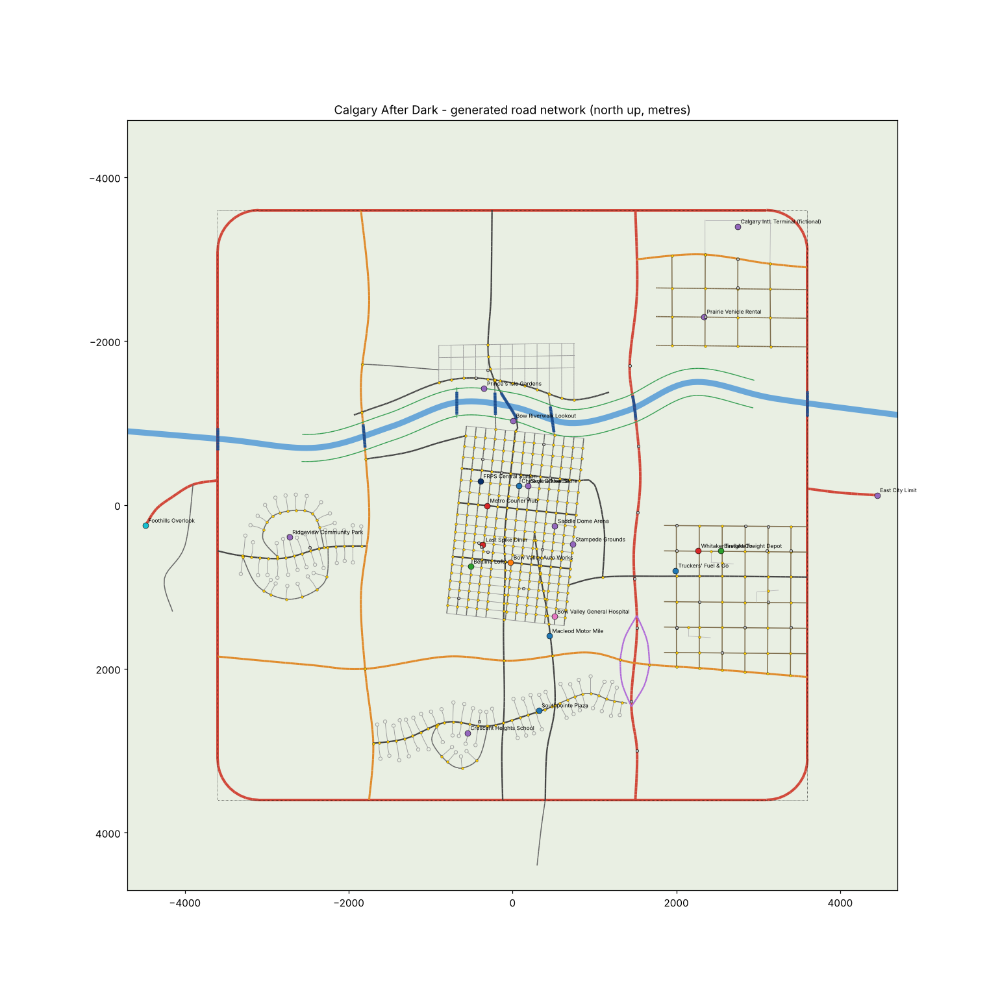

# CALGARY AFTER DARK

*The city is yours. Every decision has a price.*

An original, GTA-inspired, third-person open-world action game set in a fictionalized Calgary, Alberta, built as a
native **Unreal Engine 5 C++ project** for Windows.

> ## Read this first - honest status
>
> The environment this project was written in has **no Unreal Engine, no Windows, no GPU and no Visual Studio**
> (Linux sandbox, 4 CPUs, no display). Per the project rules, the engine was **not** swapped; the full UE5 project was
> written anyway. That means:
>
> * **The game has never been compiled or launched.** Expect a first build to need a handful of small compile fixes
>   (I wrote ~11,000 lines of engine C++ against API knowledge of UE 5.4 without a compiler for it).
> * **Nothing has been visually or interactively tested.** Frame rate, driving feel, AI behaviour and visuals are
>   unmeasured.
> * What **was** verified here, for real: the generated map and gameplay data, and the engine-independent core
>   (road graph, A* routing with turn rules, lane paths, traffic signals, terrain model) - compiled with g++ against
>   a small UE mock and run on the actual map data. See [TESTING.md](TESTING.md) and [PROJECT_STATUS.md](PROJECT_STATUS.md).



*(Generated road network - 6,771 road segments, 430 signalised intersections, river with 8 crossings, interchange, ring
road, five districts. North is up. See "The map".)*

---

## What you need to install (Windows 10/11 x64)

I checked the build environment: **none of the following was present**, so all of it is required to build and play.

| Requirement | Exact version / component |
|---|---|
| Unreal Engine | **5.4.x** via the Epic Games Launcher (the code targets 5.4 APIs; 5.5+ may need small fixes) |
| Visual Studio | **2022**, workloads **"Game development with C++"** and **"Desktop development with C++"**, with MSVC v143 and a Windows 10/11 SDK |
| .NET | .NET 6+ SDK (installed by the Unreal prerequisites / VS workload) |
| GPU | DirectX 12 capable (Lumen is enabled). A recent mid-range GPU is recommended. |
| Python 3.10+ (optional) | only for regenerating map/data tables (`Tools/`) |

Nothing else: no paid services, no online account, no downloaded art. All visible content is built from Unreal's own
`/Engine/BasicShapes` primitives.

## Build and run

1. Copy / clone this folder to a **short path** (e.g. `C:\Dev\CalgaryAfterDark`) - Unreal has path-length limits.
2. Right-click `CalgaryAfterDark.uproject` -> **Switch Unreal Engine version...** -> pick your 5.4.x install
   (only needed if it does not already map to it), then **Generate Visual Studio project files**.
3. Open `CalgaryAfterDark.sln`, set **Development Editor / Win64**, and **Build** (or just double-click the
   `.uproject` and answer *Yes* to "rebuild modules").
4. **Recommended one-time setup** (creates the PBR/emissive materials for night lighting and water):
   ```
   "C:\Program Files\Epic Games\UE_5.4\Engine\Binaries\Win64\UnrealEditor-Cmd.exe" "C:\Dev\CalgaryAfterDark\CalgaryAfterDark.uproject" -run=CADSetup
   ```
   Without it the game still runs, using the engine's colour-only `BasicShapeMaterial` (no glowing windows, lamps,
   signals, or translucent water).
5. Open the project in the editor and press **Play** (Selected Viewport or Standalone Game). The project boots on the
   stock empty `/Engine/Maps/Entry` map; the game mode builds the city at runtime from `Content/Data`.
6. Shipping build: *Platforms -> Windows -> Package Project*. `Content/Data` is staged automatically
   (`DirectoriesToAlwaysStageAsNonUFS` in `Config/DefaultGame.ini`).

If the first build reports errors, they are most likely small API drifts - see "Known limitations".

## Controls (defaults, rebindable in Settings)

| Action | Keyboard / Mouse | Gamepad |
|---|---|---|
| Move / steer / throttle & brake | **W A S D** | Left stick; RT / LT in vehicles |
| Camera | Mouse | Right stick |
| Sprint | **Shift** | L3 |
| Jump / handbrake | **Space** | A (on foot) / RB (vehicle) |
| Interact, enter / exit vehicle, advance dialogue | **E** | Y |
| Map (click = waypoint, right click = clear, wheel = zoom, WASD = pan) | **M** | Back |
| Inventory & status | **Tab** | D-pad up |
| Headlights | **H** | D-pad left |
| Flip vehicle upright | **R** | D-pad down |
| Pause | **Esc** | Start |

Menus: mouse, or Up/Down/Enter/Esc (or D-pad / A / B).

## How to play

* New Game starts you at the Bow Valley hostel in the Beltline. Your map waypoint points at the **Last Spike Diner** -
  walk (or sprint) there and press **E** on the gold marker to meet **Marcy Delorme**, your fixer. That begins
  mission 1.
* **Gold markers**: mission givers (grey = nothing available). **Blue**: shops. **Orange**: garage. **Green**: properties.
* Take **Courier Runs** at *Metro Courier Hub* (downtown) for repeatable money.
* Buy a vehicle at **Macleod Motor Mile**, upgrade/paint/repair it at **Bow Valley Auto Works**, buy the **Beltline Loft**
  (save point, 2 vehicle slots) or the **Eastlake Freight Depot** (a business that pays $600 per in-game day).
* Crimes only count if witnessed. If police see you they pursue; break line of sight and stay hidden, or you will be
  arrested if you stop beside them.
* Explore: 11 landmarks and overlooks pay a discovery bonus.

### Missions (all data-driven, all with full dialogue)

1. **Welcome to Calgary** - walk, take the loaner Kestrel, pick up a bakery order, learn the map, deliver downtown. *Keep the car.*
2. **Downtown Delivery** - timed contract run with parking at both ends; time bonus.
3. **The Missing Vehicle** - search three industrial yards, then choose: return it (legit), pay Hector, or sell it to wreckers (criminal; police notice).
4. **Highway Pressure** - six timed checkpoints on Prairie Trail through dense traffic in a borrowed Stampede RS.
5. **The Rival Contract** - Dante Kowalczyk: **negotiate** (needs business reputation), **race** his rival driver, or **wreck his convoy truck**.
6. **After Dark** - night job: collect a package, shake Dante's crew, lose the police (3 stars), meet at the Bow, then decide: Inspector Calloway, Dante, or the river. Three endings.

Reputations (Public / Business / Underworld) and police attention are tracked and saved. Missions can be restarted
from their last checkpoint after failure.

## Project layout

```
CalgaryAfterDark/
  CalgaryAfterDark.uproject        UE 5.4 project (C++ module + Enhanced Input + ProceduralMeshComponent)
  Config/                          engine/game/input .ini (physics substepping, Lumen, packaging)
  Content/Data/*.csv               ALL game data (read into UDataTables at startup)
  Source/CalgaryAfterDark/         the game module (see below)
  Tools/                           Python generators + validators, offline C++ core test
  Docs/                            map preview
  README.md  PROJECT_STATUS.md  DECISIONS.md  TESTING.md  LICENSES.md
```

### C++ architecture (`Source/CalgaryAfterDark`)

| System | Files |
|---|---|
| Bootstrap & state machine, death/arrest, save glue | `CADGameMode`, `CADGameInstance`, `CADSaveGame` |
| Data tables (vehicles, upgrades, items, shops, properties, locations, missions, stages, road graph) | `CADTypes.h`, `CADDataSubsystem` |
| World model | `CADTerrain`, `CADRoadNetwork` (graph, A*, lane paths, signals) |
| World streaming + procedural city | `CADWorldStreamer`, `CADChunk` (+`CADChunkBuildings`) |
| Player & camera | `CADPlayerCharacter`, `CADHumanoid`, `CADPlayerController` (Enhanced Input built in code) |
| Vehicles | `CADVehicle` (raycast-wheel rigid-body physics), `CADVehicleDriver` (AI) |
| Traffic / pedestrians / police | `CADTrafficSubsystem`, `CADPedestrian(+Subsystem)`, `CADPoliceSubsystem` |
| Missions, interactions, markers | `CADMissionSubsystem`, `CADInteractionSubsystem`, `CADMarker` |
| Economy, garage/ownership, properties | `CADEconomySubsystem`, `CADFleetSubsystem` |
| Weather, day/night, sky | `CADEnvironmentSubsystem` |
| Audio (procedural, optional) | `CADAudioSubsystem` |
| UI (canvas, no UMG assets) | `CADHUD` (+`CADHUDScreens`, `CADHUDMap`, `CADHUDShops`) |
| Shared primitives/materials | `CADAssets`, `CADSetupCommandlet` (editor-only) |

### The map

Real Calgary geography as inspiration, fictional streets and businesses: the Bow River crossing west-to-east with eight
bridges, a rotated downtown grid and skyline cluster with an observation tower and arena, the Beltline, a north-bank
neighbourhood, suburbs with cul-de-sacs, an industrial/freight district, an airport-side commercial zone, the
**Prairie Trail** freeway (with a diamond interchange and two overpasses), **Stoney Ring Road**, **Chinook Trail**,
**Glen Trail**, **Macleod Trail**, **Trans-Canada West** climbing to the foothills overlook, and distant Rocky
Mountain silhouettes. Playable bounds are about 9.4 km x 9.4 km, streamed in 500 m cells.

## Data-driven workflow

Edit content in `Tools/build_tables.py` (vehicles, upgrades, shops, properties, missions, stages, dialogue) or
`Tools/generate_map.py` (roads, river, locations), then:

```
python3 Tools/run_validation.py      # regenerates Content/Data/*.csv and validates everything
```

Adding a mission needs no C++: add a `mission(...)` plus `stage(...)` calls. Stage types: `Dialogue GoTo DriveTo
EnterVehicle FindVehicle Checkpoints Choice Evade Ram Race Escape OpenMap Complete`; effects:
`cash+N rep_business+N heat+N wanted=N flag:x grant:vehicle time=HH.H`. The CSV files are also importable as normal
UE DataTables (row structs in `CADTypes.h`).

## Development workflow

* Console commands (backtick in PIE): `CADGiveCash 5000`, `CADTeleport diner`, `CADTime 21`, `CADWeather 2`
  (0 clear, 1 cloudy, 2 rain, 3 fog, 4 snow), `CADWanted 3`, `CADSpawn stampede`, `CADStats`.
* Logs use the `LogCAD` category.
* Streaming radius, traffic and pedestrian density, FOV, minimap behaviour are in-game Settings.

## Known limitations (be aware)

* **Never compiled/launched** (see top). Expect small build fixes.
* Visuals are stylised primitives (cubes/cylinders/spheres): no authored meshes, textures or skeletal animation.
  Humanoids are limb-swinging primitives, not animated skeletal meshes. No interiors (you cannot enter buildings).
* Vehicles use a custom raycast-suspension model on Chaos rigid bodies, **not** Chaos Vehicle assets (see DECISIONS.md).
  Vehicle damage is a health value and darkening paint, not mesh deformation.
* The world is streamed by a custom runtime chunk system rather than editor World Partition cells (needs authored
  levels); navigation uses a custom road/sidewalk graph, not NavMesh.
* Music is not included; audio is procedural (engine, wind, rain, city hum, siren, impacts, footsteps).
* Roadmap features not in this build: combat/weapons, interiors, more districts, mod-shop visuals, replay system,
  multiple save slots, the airline/airport interior.

## Roadmap for expanding Calgary

1. Verify/compile in editor, profile, tune vehicle feel and chunk build budget.
2. Author real art: replace primitive building/vehicle/character meshes (the generator already outputs yaw, footprint
   and height per building), add skeletal characters and animation blueprints.
3. Convert the generator output to a World Partition level (one data layer per district) for editor-authoring.
4. Chaos Vehicle blueprints for the top-tier cars (keep the arcade model for traffic).
5. NavMesh for pedestrian crowds (Mass AI) and police on foot; interiors and shops.
6. More districts (Inglewood, Kensington detail, University, Stampede Park full), Banff/Canmore foothill expansion,
   streetcar/CTrain lines, seasons, licensed or composed music, more missions and a property market.
7. Dedicated QA pass: automated functional tests (Gauntlet), performance capture, packaged-build soak test.

See [PROJECT_STATUS.md](PROJECT_STATUS.md) for the feature checklist and [TESTING.md](TESTING.md) for the test plan.
