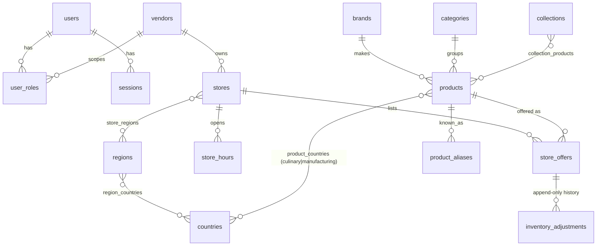

# Architecture & decisions

## ADR-001: Modular monolith, TypeScript end to end
One Fastify API, one PostgreSQL database, one React app with role-based areas (customer now; vendor, admin and driver areas follow).
No microservices: a single deployable is cheaper to run and easier to keep transactionally correct (stock, orders, payments).
Plain SQL migrations + `pg` with parameterised queries: the money/stock logic is clearer in SQL than behind an ORM.

## ADR-002: Catalogue is shared; offers are per store
`products` hold identity and descriptive facts. `store_offers` hold each store's price, stock and active flag.
The same garri can be sold by three stores at three prices without duplicating catalogue data.

## ADR-003: Money is integer cents (CAD)
No floats anywhere. Currency/tax/commission/fees will live in `app_settings` and be audited when changed.

## ADR-004: Search = Postgres trigram + verified aliases
`pg_trgm` gives typo tolerance (`shitto` -> Shito) with no extra infrastructure at pilot catalogue sizes.
`product_aliases.verified` gates matching: an unreviewed alias is never searchable, so we cannot imply an
ingredient equivalence (allergen/dietary risk). Results show "Also known as" when matched through an alias.
Every query is logged in `search_events` for unmet-demand analysis. Revisit a dedicated search engine only when measured need appears.

## ADR-005: Sessions, not JWTs
Opaque random token in an HttpOnly, SameSite=Lax cookie; only the SHA-256 is stored, so a database leak does not leak sessions
and sessions can be revoked. Passwords: scrypt. Mutations also reject mismatched `Origin`. Auth endpoints are rate limited.

## ADR-006: Authorization is checked per resource
Roles live in `user_roles`; vendor roles are scoped to a vendor. Every vendor route verifies the store belongs to the caller's vendor
(`canManageStore`) - never just "is a vendor". Tests prove cross-vendor access is denied.

## ADR-007: Orderable = published store AND approved vendor
Encoded once in the `storefronts` view (also computes open-now in the store's timezone) and used by every public query.

## Data model (implemented in M1)

Integrity rules enforced in the database: `stock_on_hand >= 0`, `stock_reserved <= stock_on_hand`, `compare_at > price`,
stock history and audit log reject UPDATE/DELETE.

## Planned for the order/payment milestone (design, not yet built)
- `orders` (customer-level) -> `suborders` (one per store) -> `order_lines` (snapshot of name/price/qty).
- Order status and payment status are separate state machines; an order is *paid* only from a verified provider webhook.
- `payments` / `payment_events` keyed by provider event id (idempotent webhooks); idempotency keys on create.
- `inventory_reservations` taken in the checkout transaction with `SELECT ... FOR UPDATE` (the pattern the stock-adjust endpoint already uses), released on payment failure/expiry.
- Append-only `ledger_entries`; refunds and corrections are reversals, never edits.
- Provider: Stripe Connect is the leading candidate for multi-vendor payouts in Canada; **must be verified against Stripe's current Canadian marketplace terms before live use**. Helcim to be evaluated for marketplace payout support. Test mode only until credentials and a decision exist.

## Regional taxonomy
Regions, countries and the mapping are rows. A country may sit in several regions (Cameroon: West and Central). Products carry
*culinary association* and *manufacturing origin* separately. Collections are rows (manual items, or region/category rules).
